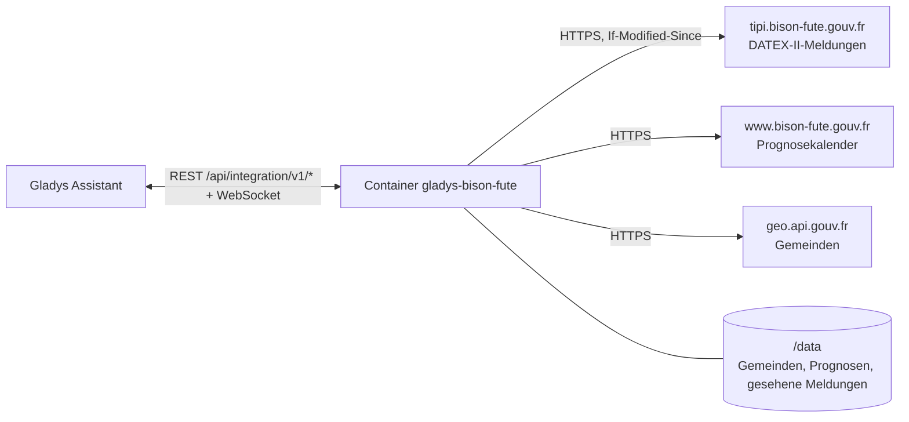
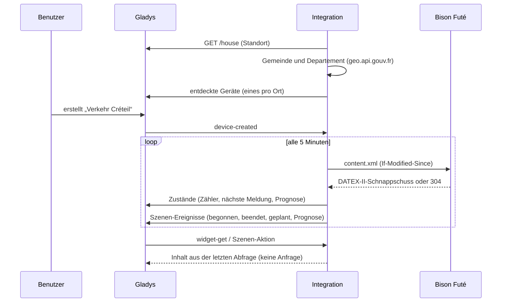
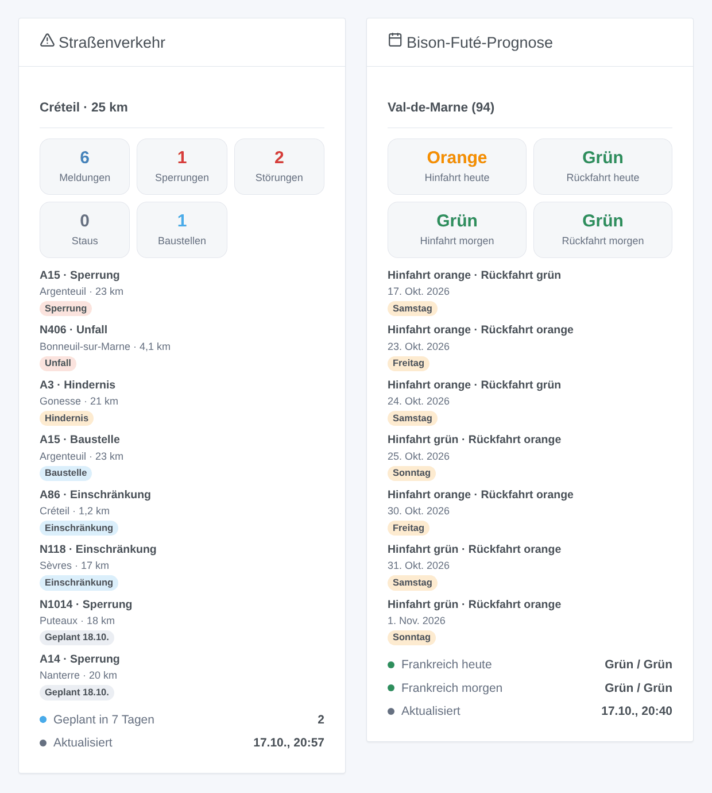

# Gladys Bison Futé

[English](README.md) · [Français](README.fr.md) · **Deutsch** · [Español](README.es.md)

[](LICENSE)
[](https://github.com/William-De71/gladys-bison-fute/releases)
[](https://github.com/William-De71/gladys-bison-fute/actions/workflows/release.yml)
[](https://gladysassistant.com)


Externe Integration für [Gladys Assistant](https://gladysassistant.com) zu **Bison Futé**, dem französischen Verkehrsinformationsdienst: Sperrungen, Unfälle, Staus und Baustellen rund um Ihr Zuhause auf den Nationalstraßen sowie die grüne, orange, rote oder schwarze Verkehrsprognose Ihres Departements. Kein Konto und kein Schlüssel: Sie liest die offenen Daten der staatlichen Straßenbehörden.

Benutzerdokumentation: [English](docs/en.md) · [Français](docs/fr.md) · [Deutsch](docs/de.md) · [Español](docs/es.md).

> Community-Integration, nicht verbunden mit oder unterstützt von Bison Futé, dem französischen Verkehrsministerium oder den Straßenbehörden (DIR).

## Funktionen

- **Ein Gerät pro Ort** (ein Haus von Gladys oder eine Gemeinde, bis zu drei), mit einem **Radius** (1 bis 200 km) und auf Wunsch **nur den Straßen Ihrer Strecke** („N79, A6“).
- **Verkehrsmeldungen** der Zone: alle, Sperrungen, Unfälle und Hindernisse, Staus, Baustellen, und die nächste als Text.
- **Bison-Futé-Prognose** des Departements: Hin- und Rückfahrt, heute und morgen (grün, orange, rot, schwarz), für das französische Festland.
- **4 Szenen-Auslöser**, **2 Szenen-Aktionen** und **2 Dashboard-Widgets** (siehe unten).
- Standardmäßig alle 5 Minuten ein kleiner Download (etwa 150 KB, nichts, wenn sich der Feed nicht geändert hat); die Prognosen alle sechs Stunden.
- Überall vier Sprachen: Englisch, Französisch, Deutsch, Spanisch.

## Funktionsweise




Die Integration fragt Gladys nach dem Standort des gewählten Hauses, ermittelt Gemeinde und Departement über geo.api.gouv.fr und liest dann den DATEX-II-Schnappschuss des nationalen Straßennetzes, den die Straßenbehörden (DIR) auf Bison Futé veröffentlichen: etwa 250 Situationen für ganz Frankreich, jeweils mit Art, Straße, Ort und Zeitraum. Sie behält die Meldungen im Radius jedes Ortes (und auf seinen Straßen, falls angegeben), sortiert sie (zuerst Sperrungen und Unfälle, dann die nächsten) und vergleicht sie mit der vorherigen Abfrage, um die Szenen-Auslöser zu feuern. Die Prognosen stammen aus dem Kalender der Website bison-fute.gouv.fr.



### Transport

Nur Cloud (`"transports": ["cloud"]`): Der Katalog zeigt das Cloud-Abzeichen. Die Integration kontaktiert `tipi.bison-fute.gouv.fr`, `www.bison-fute.gouv.fr` (öffentliche Dateien, kein Konto, außer einer normalen Anfrage wird nichts gesendet) und `geo.api.gouv.fr` (nur die Koordinaten des gewählten Hauses oder die eingegebene Gemeinde). Sonst verlässt nichts Ihr Netzwerk; es gibt keinen lokalen Zugang und daher keine Schaltfläche „Lokale Verbindung bevorzugen“.

## Geräte und Funktionen

| Funktion                                                                  | Kategorie / Typ              | Werte                              |
| ------------------------------------------------------------------------- | ---------------------------- | ---------------------------------- |
| Verkehrsmeldungen, Sperrungen, Unfälle und Hindernisse, Staus, Baustellen | `counter-sensor` / `integer` | 0 … 999 aktive Meldungen der Zone  |
| Nächste Verkehrsmeldung                                                   | `text` / `text`              | „N79 · Unfall · 3,2 km“            |
| Prognose Hinfahrt, Rückfahrt, heute, morgen                               | `risk` / `integer`           | 0 grün, 1 orange, 2 rot, 3 schwarz |

Die Prognose-Funktionen gibt es nur dort, wo Bison Futé Prognosen veröffentlicht (französisches Festland ohne Korsika). Gladys zeigt die `risk`-Stufen als kein, geringes, mittleres und hohes Risiko; die Widgets zeigen die Farben von Bison Futé. Eine Meldung ist zwischen Beginn und Ende aktiv; eine geplante zählt ab ihrem Beginn, eine ausgesetzte zählt nicht.

**Was der Feed abdeckt**: die Nationalstraßen und die mautfreien Autobahnen der staatlichen Straßenbehörden (DIR), Île-de-France eingeschlossen. Mautautobahnen (Vinci, APRR, Sanef…) und Departementstraßen sind nicht in diesem offenen Feed: Ein Stau auf einer Mautautobahn wird nicht erkannt.

## Szenen-Auslöser, Aktionen und Widgets



**Szenen-Auslöser** (einmal pro Übergang; die erste Abfrage eines Ortes dient als Referenz und löst nichts aus):

- **Verkehrsmeldung begonnen**: Eine Meldung wird in der Zone aktiv (ein Unfall, eine beginnende Sperrung, ein Stau). Filter: Ort, Arten, Straße.
- **Verkehrsmeldung beendet**: Eine aktive Meldung ist beendet (die Straße ist wieder frei). Filter: Ort, Arten, Straße.
- **Verkehrsmeldung geplant**: Eine neue Meldung wird für die nächsten sieben Tage angekündigt (eine nächtliche Sperrung wegen Bauarbeiten). Filter: Ort, Arten, Straße.
- **Orange, rote oder schwarze Prognose**: für heute ab 6 Uhr, für morgen ab 18 Uhr am Vortag, erneut bei Verschlechterung. Filter: Ort, Tag, Richtung, Stufen.

**Szenen-Aktionen**: **Verkehrsmeldungen lesen** für einen Ort (Zähler, nächste Meldung, eine fertige Liste) und **Prognose lesen** für heute oder morgen (Stufen, Frankreich, nächster oranger oder schlechterer Tag, eine Zusammenfassung).

**Widgets**: **Straßenverkehr** (Zähler, aktive und geplante Meldungen, Aktualisierungszeit) und **Bison-Futé-Prognose** (Hin- und Rückfahrt heute und morgen, nächste farbige Tage, Frankreich).

Beispiele:

- Wenn **eine Sperrung oder ein Unfall auf der N118 beginnt** → `{{triggerEvent.data.summary}}` vor der Abfahrt aufs Handy senden.
- Wenn **die Prognose für morgen für die Hinfahrt rot ist** → die Familie am Vorabend an eine frühe Abfahrt erinnern.
- Jeden Werktag um 7:30 Uhr → **Verkehrsmeldungen** des Arbeitsorts lesen und, wenn `count` größer als 0 ist, die Liste `summary` senden.

## Voraussetzungen

- Gladys Assistant **5.2.0** oder neuer (Hausauswahl in der Konfiguration). Ältere Instanzen können die Integration nicht installieren.
- Ein Haus von Gladys mit Standort oder der Name einer französischen Gemeinde. Kein Konto, kein Schlüssel.

## Installation

- **Aus dem Store** von Gladys (Integrationen → Externe Integrationen), mit einem Klick, sobald indexiert.
- **Über die Repository-URL**: `https://github.com/William-De71/gladys-bison-fute`.
- **Entwicklermodus**: Das Image lokal bauen (`docker build -t gladys-bison-fute .`) und in Gladys installieren.

## Konfiguration

| Feld                         | Beschreibung                                                                         |
| ---------------------------- | ------------------------------------------------------------------------------------ |
| Haus (1 bis 3)               | Ein Haus von Gladys: sein Standort ist der Mittelpunkt der Zone.                     |
| Oder eine Gemeinde (1 bis 3) | „Mâcon“, „71000“, „Saint-Denis 93200“ oder der INSEE-Code; hat Vorrang vor dem Haus. |
| Radius (km)                  | 1 bis 200 km, standardmäßig 20.                                                      |
| Nur diese Straßen            | „N79, A6“: nur die Meldungen dieser Straßen. Leer: alle Straßen der Zone.            |
| Meldungen gelesen alle       | 2, 5 (Standard), 10, 15 oder 30 Minuten.                                             |
| Sprache der Texte            | Gerätenamen, nächste Meldung, Szenen-Zusammenfassungen.                              |

Schaltflächen: **Jetzt lesen** (höchstens einmal pro Minute) und **Diagnose** (schreibt Orte, Meldungen jeder Zone und den letzten Fehler in den Tab Protokolle).

## Verwendung

1. Wählen Sie ein Haus (oder geben Sie eine Gemeinde ein), stellen Sie den Radius und auf Wunsch Ihre Straßen ein und speichern Sie.
2. Erstellen Sie im Tab **Entdecken** das Gerät „Verkehr …“ jedes Ortes.
3. Fügen Sie die Widgets **Straßenverkehr** und **Bison-Futé-Prognose** einem Dashboard hinzu und erstellen Sie Szenen mit den obigen Auslösern.

## Entwicklung

```bash
npm install
npm test                       # node --test, nie mit Netzwerkzugriff
npm run lint && npm run format:check
npx github:GladysAssistant/integration-store . --skip-image-check
scripts/build-cover.sh         # cover.jpg aus docs/assets/cover.svg
docs/illustrations/render.sh   # docs/assets/widgets.<sprache>.png
node .github/scripts/release.mjs next
```

Lokal liest das SDK `GLADYS_HOST_API_URL`, `GLADYS_INTEGRATION_TOKEN` und `GLADYS_INTEGRATION_SELECTOR`; `DEBUG=gladys-integration-sdk` zeigt die SDK-Protokolle und prüft jeden Widget-Inhalt. Die Tests verwenden echte, verkleinerte Dateien von Bison Futé (`test/fixtures/`). Die Projektregeln stehen in [CLAUDE.md](CLAUDE.md).

## Release-Prozess


Jeder Merge auf `main` startet die CI und berechnet dann die Version aus den [Conventional Commits](https://www.conventionalcommits.org/de/) seit dem letzten Tag: `feat` → Minor, `fix` / `perf` → Patch, `!` oder `BREAKING CHANGE` → Major (Minor unter 1.0.0); `docs`, `chore`, `ci`, `test`, `style`, `refactor`, `build` allein veröffentlichen nichts. Der Changelog-Abschnitt wird erzeugt, der Tag gepusht, das Multi-Architektur-Image gebaut, dann erhält `main` den Release-Commit, die GitHub Release wird erstellt und ein letzter Job prüft das öffentliche Image, den Store-Validator und das Topic.

- Der Titel des Pull Requests wird zum Squash-Commit und dann zur Changelog-Zeile: Schreiben Sie ihn auf Englisch, für den Benutzer (`pr-title.yml` prüft ihn). Bearbeiten Sie `CHANGELOG.md` nie von Hand.
- 1.0.0 ist eine Entscheidung: Actions → Release → Run workflow mit `release-as: 1.0.0`. `dry-run` zeigt Version und Notizen ohne Veröffentlichung.
- **Geschützter Branch**: Die Release pusht ihren Commit mit `GITHUB_TOKEN` auf `main`. Mit einem Ruleset auf `main` fügen Sie GitHub Actions zur Bypass-Liste hinzu (oder pushen über eine GitHub App), sonst schlägt der Veröffentlichungsjob mit Anweisungen fehl.
- Machen Sie nach der ersten Release das `ghcr.io`-Paket öffentlich (Package settings → Change visibility), sonst kann Gladys es nicht herunterladen.

## Fehlerbehebung

Siehe [docs/de.md](docs/de.md#fehlerbehebung). Melden Sie Probleme mit den Versionen von Gladys und der Integration, dem Ort und den Zeilen der Schaltfläche **Diagnose**.

## Mitwirken

Issues und Pull Requests sind willkommen. Führen Sie `npm run format:check && npm run lint && npm test` aus, bevor Sie einen Pull Request öffnen, und ändern Sie keine externe ID und keinen gespeicherten Schlüssel (siehe [CLAUDE.md](CLAUDE.md)).

## Sicherheit

Siehe [SECURITY.md](SECURITY.md): Melden Sie Schwachstellen vertraulich. Die Integration hat kein Geheimnis zu schützen: Sie liest öffentliche Dateien, sendet nur den Standort des gewählten Hauses an geo.api.gouv.fr und läuft schreibgeschützt, als Nicht-Root-Benutzer, in ihrem Container.

## Kommende Screenshots

Die Bilder oben sind Illustrationen, keine Screenshots. Echte Screenshots kommen nach `docs/assets/screenshots/` (PNG, 1280 × 800): `configuration.png`, `discovery.png`, `device.png`, `scene.png`.

## Lizenz

[Apache License 2.0](LICENSE) — siehe auch [NOTICE](NOTICE). Die Verkehrsmeldungen sind offene Daten der staatlichen Straßenbehörden (DIR), veröffentlicht von Bison Futé unter der Licence Ouverte 2.0 (Etalab): Die Widgets zeigen die Quelle jeder Meldung und die Aktualisierungszeit. Dank an die Dokumentation und das SDK von Gladys sowie an die Teams von Bison Futé und transport.data.gouv.fr für die Öffnung dieser Daten.
