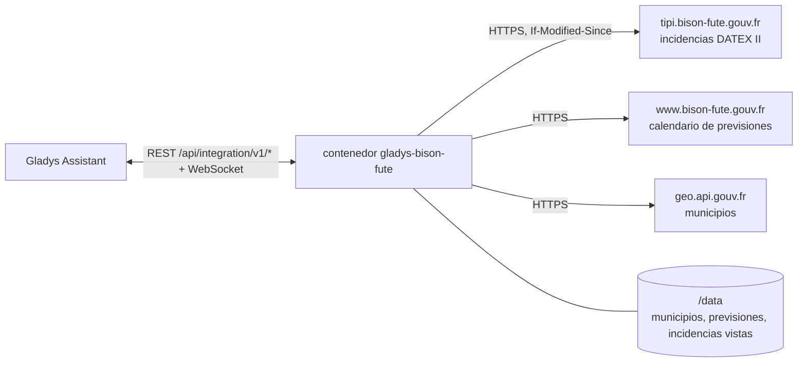
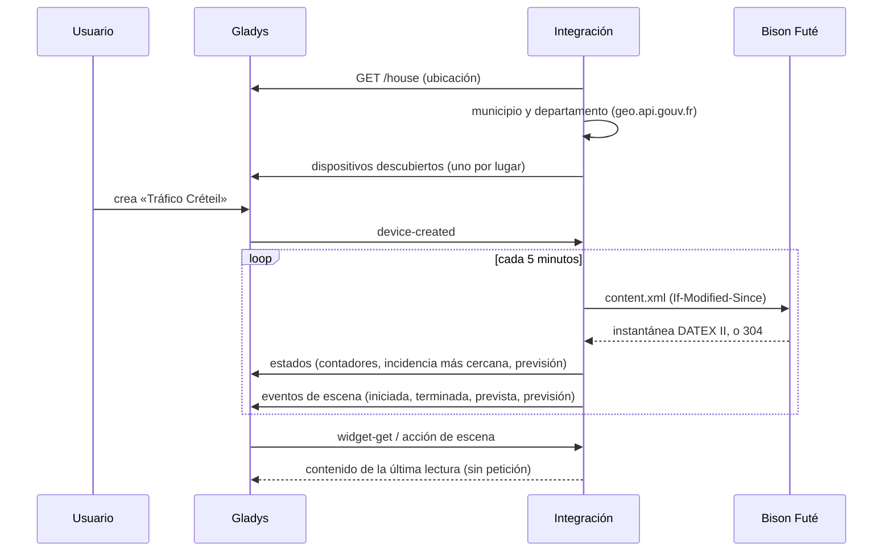
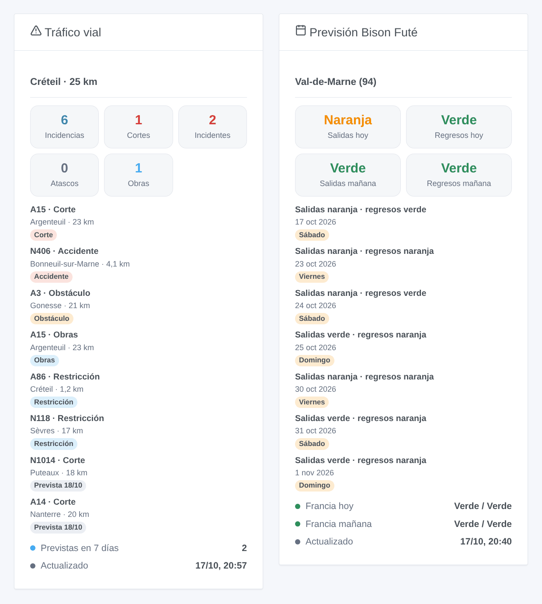

# Gladys Bison Futé

[English](README.md) · [Français](README.fr.md) · [Deutsch](README.de.md) · **Español**

[](LICENSE)
[](https://github.com/William-De71/gladys-bison-fute/releases)
[](https://github.com/William-De71/gladys-bison-fute/actions/workflows/release.yml)
[](https://gladysassistant.com)


Integración externa de [Gladys Assistant](https://gladysassistant.com) para **Bison Futé**, el servicio francés de información vial: los cortes, accidentes, atascos y obras alrededor de su casa en las carreteras nacionales, y la previsión de tráfico verde, naranja, roja o negra de su departamento. Sin cuenta ni clave: lee los datos abiertos de las direcciones de carreteras del Estado.

Documentación de usuario: [English](docs/en.md) · [Français](docs/fr.md) · [Deutsch](docs/de.md) · [Español](docs/es.md).

> Integración comunitaria, sin relación con Bison Futé, el ministerio francés de transportes ni las direcciones de carreteras (DIR), ni aprobada por ellos.

## Funcionalidades

- **Un dispositivo por lugar** (una casa de Gladys o un municipio, hasta tres), con un **radio** (1 a 200 km) y, si lo desea, **solo las carreteras de su trayecto** («N79, A6»).
- **Incidencias viales** de la zona: todas, cortes, accidentes y obstáculos, atascos, obras, y la más cercana en texto.
- **Previsión de Bison Futé** del departamento: salidas y regresos, hoy y mañana (verde, naranja, rojo, negro), en la Francia metropolitana.
- **4 desencadenantes de escena**, **2 acciones de escena** y **2 widgets de panel** (más abajo).
- Una pequeña descarga cada 5 minutos por defecto (unos 150 KB, nada si el flujo no ha cambiado); las previsiones cada seis horas.
- Cuatro idiomas en todas partes: inglés, francés, alemán, español.

## Funcionamiento




La integración pide a Gladys la ubicación de la casa elegida, encuentra su municipio y su departamento en geo.api.gouv.fr y lee la instantánea DATEX II de la red nacional de carreteras que las DIR publican en Bison Futé: unas 250 situaciones para toda Francia, cada una con su tipo, su carretera, su lugar y sus fechas. Conserva las que están en el radio de cada lugar (y en sus carreteras, si las indicó), las ordena (primero cortes y accidentes, después las más cercanas) y las compara con la lectura anterior para lanzar los desencadenantes de escena. Las previsiones proceden del calendario del sitio bison-fute.gouv.fr.



### Transporte

Solo nube (`"transports": ["cloud"]`): el catálogo muestra la insignia de nube. La integración contacta con `tipi.bison-fute.gouv.fr`, `www.bison-fute.gouv.fr` (archivos públicos, sin cuenta, no se envía nada salvo una petición normal) y `geo.api.gouv.fr` (solo las coordenadas de la casa elegida o el municipio escrito). Nada más sale de su red; no hay acceso local, por lo que no hay botón «Preferir la conexión local».

## Dispositivos y funciones

| Función                                                             | Categoría / tipo             | Valores                                |
| ------------------------------------------------------------------- | ---------------------------- | -------------------------------------- |
| Incidencias viales, cortes, accidentes y obstáculos, atascos, obras | `counter-sensor` / `integer` | 0 … 999 incidencias activas de la zona |
| Incidencia más cercana                                              | `text` / `text`              | «N79 · Accidente · 3,2 km»             |
| Previsión salidas, regresos, hoy, mañana                            | `risk` / `integer`           | 0 verde, 1 naranja, 2 rojo, 3 negro    |

Las funciones de previsión solo existen donde Bison Futé publica previsiones (Francia metropolitana sin Córcega). Gladys muestra los niveles `risk` como riesgo nulo, bajo, medio y alto; los widgets muestran los colores de Bison Futé. Una incidencia está activa entre su inicio y su fin; una prevista cuenta desde que empieza, una suspendida no cuenta.

**Qué cubre el flujo**: las carreteras nacionales y las autopistas sin peaje gestionadas por las DIR, Île-de-France incluida. Las autopistas de peaje (Vinci, APRR, Sanef…) y las carreteras departamentales no están en este flujo abierto: un atasco en una autopista de peaje no se ve.

## Desencadenantes, acciones de escena y widgets



**Desencadenantes de escena** (una vez por transición; la primera lectura de un lugar sirve de referencia y no lanza nada):

- **Incidencia vial iniciada**: una incidencia se activa en la zona (un accidente, un corte que empieza, un atasco). Filtros: lugar, tipos, carretera.
- **Incidencia vial terminada**: una incidencia activa ha terminado (la carretera se reabre). Filtros: lugar, tipos, carretera.
- **Incidencia vial prevista**: se anuncia una nueva incidencia para los próximos siete días (un corte nocturno por obras). Filtros: lugar, tipos, carretera.
- **Previsión naranja, roja o negra**: para hoy desde las 6 h, para mañana desde las 18 h del día anterior, de nuevo si empeora. Filtros: lugar, día, sentido, niveles.

**Acciones de escena**: **leer las incidencias viales** de un lugar (contadores, incidencia más cercana, una lista lista para enviar) y **leer la previsión** de hoy o de mañana (niveles, Francia, próximo día naranja o peor, un resumen).

**Widgets**: **Tráfico vial** (contadores, incidencias activas y luego previstas, hora de actualización) y **Previsión Bison Futé** (salidas y regresos hoy y mañana, próximos días coloreados, Francia).

Ejemplos:

- Cuando **empieza un corte o un accidente en la N118** → enviar `{{triggerEvent.data.summary}}` a su teléfono antes de salir.
- Cuando **la previsión de mañana es roja en el sentido de las salidas** → recordar a la familia la víspera que salga temprano.
- Cada día laborable a las 7:30 → **leer las incidencias viales** del lugar de trabajo y, si `count` es mayor que 0, enviar la lista `summary`.

## Requisitos

- Gladys Assistant **5.2.0** o posterior (selector de casa en la configuración). Las instancias más antiguas no pueden instalar la integración.
- Una casa de Gladys con su ubicación, o el nombre de un municipio francés. Sin cuenta ni clave.

## Instalación

- **Desde la tienda** de Gladys (Integraciones → Integraciones externas), en un clic, una vez indexada.
- **Desde la URL del repositorio**: `https://github.com/William-De71/gladys-bison-fute`.
- **Modo desarrollador**: construya la imagen localmente (`docker build -t gladys-bison-fute .`) e instálela desde Gladys.

## Configuración

| Campo                   | Descripción                                                                       |
| ----------------------- | --------------------------------------------------------------------------------- |
| Casa (1 a 3)            | Una casa de Gladys: su ubicación es el centro de la zona.                         |
| O un municipio (1 a 3)  | «Mâcon», «71000», «Saint-Denis 93200» o el código INSEE; prevalece sobre la casa. |
| Radio (km)              | 1 a 200 km, 20 por defecto.                                                       |
| Solo estas carreteras   | «N79, A6»: solo las incidencias de esas carreteras. Vacío: todas las de la zona.  |
| Incidencias leídas cada | 2, 5 (por defecto), 10, 15 o 30 minutos.                                          |
| Idioma de los textos    | Nombres de los dispositivos, incidencia más cercana, resúmenes de escenas.        |

Botones: **Leer ahora** (como mucho una vez por minuto) y **Diagnóstico** (escribe en la pestaña Registros los lugares, las incidencias de cada zona y el último error).

## Uso

1. Elija una casa (o escriba un municipio), ajuste el radio y, si lo desea, sus carreteras, y guarde.
2. En la pestaña **Descubrir**, cree el dispositivo «Tráfico …» de cada lugar.
3. Añada los widgets **Tráfico vial** y **Previsión Bison Futé** a un panel y cree escenas con los desencadenantes anteriores.

## Desarrollo

```bash
npm install
npm test                       # node --test, nunca accede a la red
npm run lint && npm run format:check
npx github:GladysAssistant/integration-store . --skip-image-check
scripts/build-cover.sh         # cover.jpg desde docs/assets/cover.svg
docs/illustrations/render.sh   # docs/assets/widgets.<idioma>.png
node .github/scripts/release.mjs next
```

En local, el SDK lee `GLADYS_HOST_API_URL`, `GLADYS_INTEGRATION_TOKEN` y `GLADYS_INTEGRATION_SELECTOR`; `DEBUG=gladys-integration-sdk` muestra los registros del SDK y comprueba cada contenido de widget. Las pruebas usan archivos reales de Bison Futé, reducidos (`test/fixtures/`). Las reglas del proyecto están en [CLAUDE.md](CLAUDE.md).

## Proceso de publicación


Cada fusión en `main` lanza la CI y calcula la versión a partir de los [Conventional Commits](https://www.conventionalcommits.org/es/) desde la última etiqueta: `feat` → menor, `fix` / `perf` → parche, `!` o `BREAKING CHANGE` → mayor (menor por debajo de 1.0.0); `docs`, `chore`, `ci`, `test`, `style`, `refactor`, `build` solos no publican nada. Se genera la sección del changelog, se empuja la etiqueta, se construye la imagen multiarquitectura, luego `main` recibe el commit de publicación, se crea la GitHub Release y un último job comprueba la imagen pública, el validador de la tienda y el topic.

- El título de la pull request se convierte en el commit squash y luego en la línea del changelog: escríbalo en inglés, para el usuario (`pr-title.yml` lo comprueba). No edite nunca `CHANGELOG.md` a mano.
- La 1.0.0 es una decisión: Actions → Release → Run workflow con `release-as: 1.0.0`. `dry-run` muestra la versión y las notas sin publicar.
- **Rama protegida**: la publicación empuja su commit a `main` con `GITHUB_TOKEN`. Con un ruleset en `main`, añada GitHub Actions a su lista de omisión (o empuje mediante una GitHub App); si no, el job de publicación falla con instrucciones.
- Tras la primera publicación, haga público el paquete `ghcr.io` (Package settings → Change visibility); si no, Gladys no puede descargarlo.

## Solución de problemas

Vea [docs/es.md](docs/es.md#solución-de-problemas). Informe de los problemas con las versiones de Gladys y de la integración, el lugar y las líneas del botón **Diagnóstico**.

## Contribuir

Las issues y pull requests son bienvenidas. Ejecute `npm run format:check && npm run lint && npm test` antes de abrir una pull request y no cambie ningún identificador externo ni ninguna clave guardada (vea [CLAUDE.md](CLAUDE.md)).

## Seguridad

Vea [SECURITY.md](SECURITY.md): informe de las vulnerabilidades en privado. La integración no tiene ningún secreto que guardar: lee archivos públicos, solo envía la ubicación de la casa elegida a geo.api.gouv.fr y se ejecuta en solo lectura, con un usuario sin privilegios, en su contenedor.

## Capturas pendientes

Las imágenes anteriores son ilustraciones, no capturas de pantalla. Las capturas reales irán en `docs/assets/screenshots/` (PNG, 1280 × 800): `configuration.png`, `discovery.png`, `device.png`, `scene.png`.

## Licencia

[Licencia Apache 2.0](LICENSE) — vea también [NOTICE](NOTICE). Las incidencias viales son datos abiertos de las DIR, publicados por Bison Futé bajo la Licence Ouverte 2.0 (Etalab): los widgets indican la fuente de cada incidencia y la hora de actualización. Gracias a la documentación y al SDK de Gladys, y a los equipos de Bison Futé y transport.data.gouv.fr por abrir estos datos.
