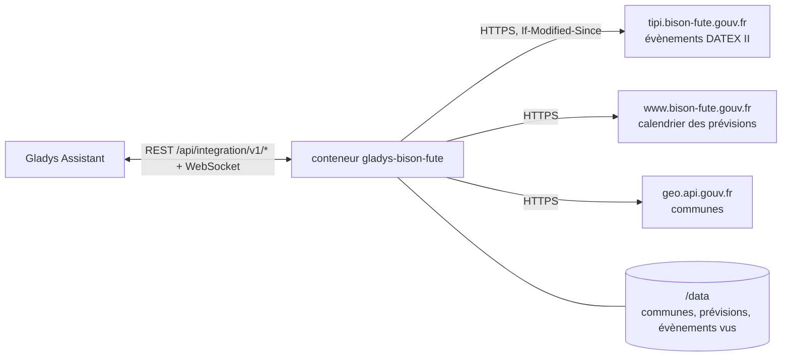
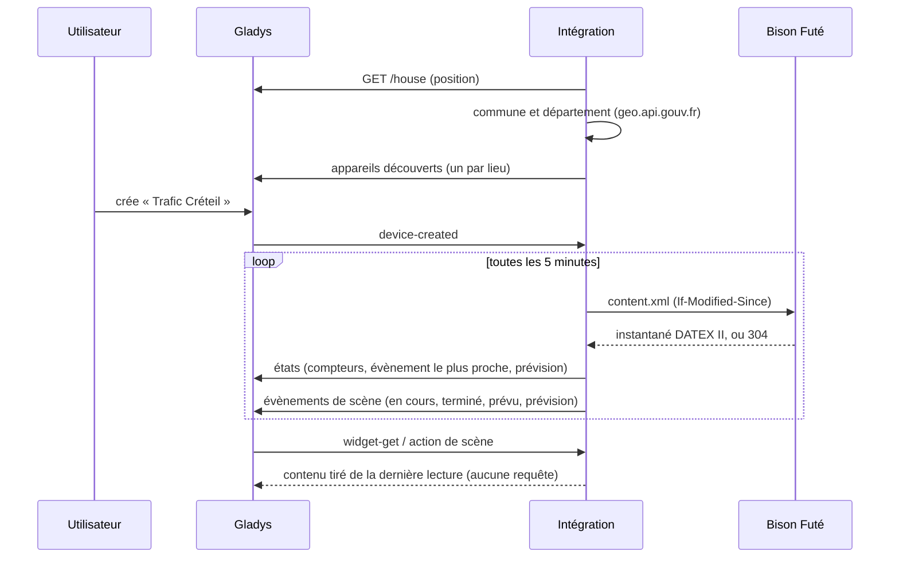
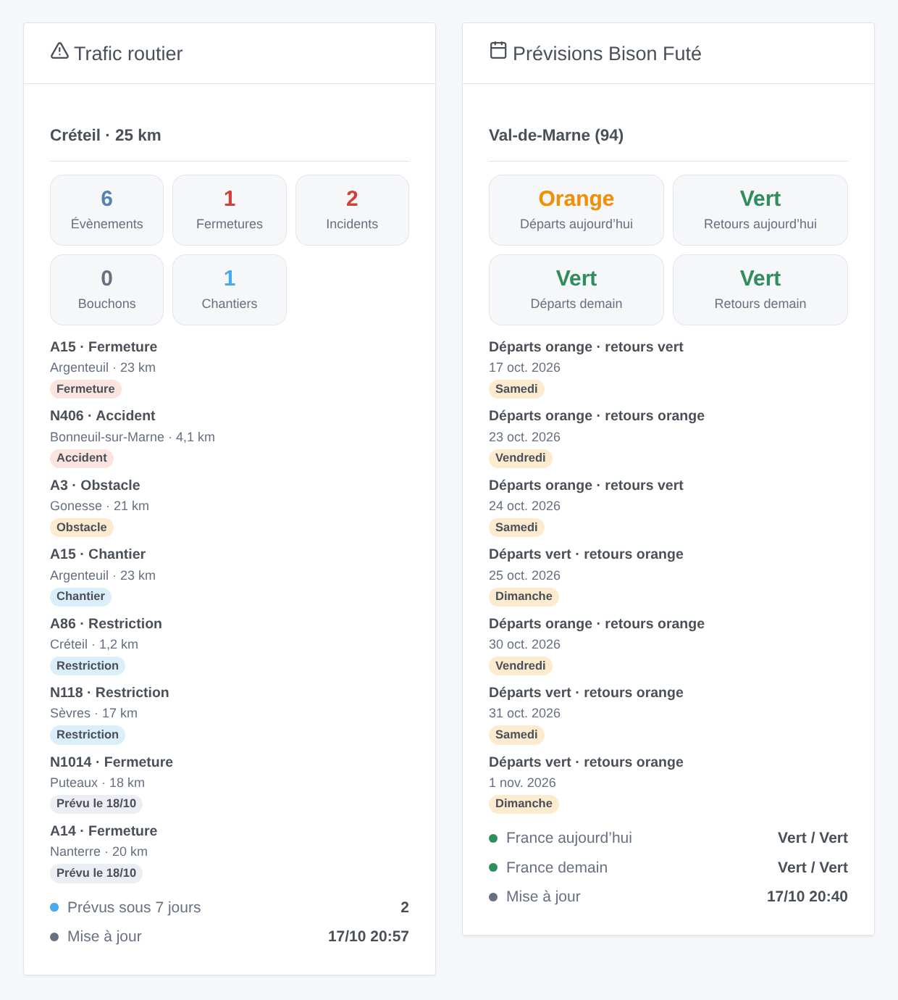

# Gladys Bison Futé

[English](README.md) · **Français** · [Deutsch](README.de.md) · [Español](README.es.md)

[](LICENSE)
[](https://github.com/William-De71/gladys-bison-fute/releases)
[](https://github.com/William-De71/gladys-bison-fute/actions/workflows/release.yml)
[](https://gladysassistant.com)


Intégration externe de [Gladys Assistant](https://gladysassistant.com) pour **Bison Futé**, le service d’information routière de l’État : les fermetures, accidents, bouchons et chantiers autour de chez vous sur les routes nationales, et la prévision de trafic verte, orange, rouge ou noire de votre département. Ni compte ni clé : elle lit les données ouvertes des directions interdépartementales des routes.

Documentation utilisateur : [English](docs/en.md) · [Français](docs/fr.md) · [Deutsch](docs/de.md) · [Español](docs/es.md).

> Intégration communautaire, sans lien avec Bison Futé, le ministère chargé des transports ni les directions interdépartementales des routes (DIR), et non approuvée par eux.

## Fonctionnalités

- **Un appareil par lieu** (une maison de Gladys ou une commune, jusqu’à trois), avec un **rayon** (1 à 200 km) et, si vous le souhaitez, **seulement les routes de votre trajet** (« N79, A6 »).
- **Évènements routiers** de la zone : tous, fermetures, accidents et obstacles, bouchons, chantiers, et le plus proche en texte.
- **Prévision Bison Futé** du département : départs et retours, aujourd’hui et demain (vert, orange, rouge, noir), en France métropolitaine.
- **4 déclencheurs de scène**, **2 actions de scène** et **2 widgets de tableau de bord** (ci-dessous).
- Un petit téléchargement toutes les 5 minutes par défaut (environ 150 Ko, rien quand le flux n’a pas changé) ; les prévisions toutes les six heures.
- Quatre langues partout : anglais, français, allemand, espagnol.

## Fonctionnement




L’intégration demande à Gladys la position de la maison choisie, trouve sa commune et son département sur geo.api.gouv.fr, puis lit l’instantané DATEX II du réseau routier national publié par les DIR sur Bison Futé : environ 250 situations pour toute la France, chacune avec son type, sa route, son lieu et ses dates. Elle garde celles qui sont dans le rayon de chaque lieu (et sur ses routes, si vous en avez listé), les trie (fermetures et accidents d’abord, puis les plus proches) et les compare à la lecture précédente pour déclencher les scènes. Les prévisions viennent du calendrier du site bison-fute.gouv.fr.



### Transport

Cloud uniquement (`"transports": ["cloud"]`) : le catalogue affiche le badge cloud. L’intégration contacte `tipi.bison-fute.gouv.fr`, `www.bison-fute.gouv.fr` (fichiers publics, sans compte, rien d’envoyé hormis une requête ordinaire) et `geo.api.gouv.fr` (seulement les coordonnées de la maison choisie ou la commune saisie). Rien d’autre ne quitte votre réseau ; il n’existe pas d’accès local, donc pas de bouton « Préférer la connexion locale ».

## Appareils et fonctionnalités

| Fonctionnalité                                                               | Catégorie / type             | Valeurs                                  |
| ---------------------------------------------------------------------------- | ---------------------------- | ---------------------------------------- |
| Évènements routiers, fermetures, accidents et obstacles, bouchons, chantiers | `counter-sensor` / `integer` | 0 … 999 évènements en cours dans la zone |
| Évènement le plus proche                                                     | `text` / `text`              | « N79 · Accident · 3,2 km »              |
| Prévision départs, retours, aujourd’hui, demain                              | `risk` / `integer`           | 0 vert, 1 orange, 2 rouge, 3 noir        |

Les fonctionnalités de prévision n’existent que là où Bison Futé publie des prévisions (France métropolitaine hors Corse). Gladys affiche les niveaux `risk` comme risque nul, faible, moyen et élevé ; les widgets montrent les couleurs de Bison Futé. Un évènement est en cours entre son début et sa fin ; un évènement prévu compte dès qu’il commence, un évènement suspendu ne compte pas.

**Ce que couvre le flux** : les routes nationales et les autoroutes non concédées, gérées par les DIR, Île-de-France comprise. Les autoroutes à péage (Vinci, APRR, Sanef…) et les routes départementales ne sont pas dans ce flux ouvert : un bouchon sur une autoroute à péage n’est pas vu.

## Déclencheurs, actions de scène et widgets



**Déclencheurs de scène** (une fois par transition ; la première lecture d’un lieu sert de référence et ne déclenche rien) :

- **Évènement routier en cours** : un évènement devient actif dans la zone (un accident, une fermeture qui commence, un bouchon). Filtres : lieu, types, route.
- **Évènement routier terminé** : un évènement actif est terminé (la route rouvre). Filtres : lieu, types, route.
- **Évènement routier prévu** : un nouvel évènement est annoncé pour les sept prochains jours (une fermeture de nuit pour chantier). Filtres : lieu, types, route.
- **Prévision orange, rouge ou noire** : pour aujourd’hui dès 6 h, pour demain dès 18 h la veille, à nouveau si elle s’aggrave. Filtres : lieu, jour, sens, niveaux.

**Actions de scène** : **lire les évènements routiers** d’un lieu (compteurs, évènement le plus proche, une liste prête à envoyer) et **lire la prévision** d’aujourd’hui ou de demain (niveaux, France, prochain jour orange ou pire, un résumé).

**Widgets** : **Trafic routier** (compteurs, évènements en cours puis prévus, heure de mise à jour) et **Prévisions Bison Futé** (départs et retours aujourd’hui et demain, prochains jours colorés, France).

Exemples :

- Quand **un évènement de type fermeture ou accident commence sur la N118** → envoyer `{{triggerEvent.data.summary}}` sur votre téléphone avant de partir.
- Quand **la prévision de demain est rouge dans le sens des départs** → rappeler la veille à la famille de partir tôt.
- Chaque jour ouvré à 7 h 30 → **lire les évènements routiers** du lieu de travail et, si `count` est supérieur à 0, envoyer la liste `summary`.

## Prérequis

- Gladys Assistant **5.2.0** ou plus récent (sélecteur de maison dans la configuration). Les instances plus anciennes ne peuvent pas installer l’intégration.
- Une maison de Gladys avec sa position, ou le nom d’une commune française. Ni compte, ni clé.

## Installation

- **Depuis le store** de Gladys (Intégrations → Intégrations externes), en un clic, une fois indexée.
- **Depuis l’URL du dépôt** : `https://github.com/William-De71/gladys-bison-fute`.
- **Mode développeur** : construisez l’image localement (`docker build -t gladys-bison-fute .`) et installez-la depuis Gladys.

## Configuration

| Champ                     | Description                                                                               |
| ------------------------- | ----------------------------------------------------------------------------------------- |
| Maison (1 à 3)            | Une maison de Gladys : sa position est le centre de la zone.                              |
| Ou une commune (1 à 3)    | « Mâcon », « 71000 », « Saint-Denis 93200 » ou le code INSEE ; prioritaire sur la maison. |
| Rayon (km)                | 1 à 200 km, 20 par défaut.                                                                |
| Seulement ces routes      | « N79, A6 » : seulement les évènements de ces routes. Vide : toutes les routes.           |
| Évènements lus toutes les | 2, 5 (par défaut), 10, 15 ou 30 minutes.                                                  |
| Langue des textes         | Noms des appareils, évènement le plus proche, résumés des scènes.                         |

Boutons : **Lire maintenant** (au plus une fois par minute) et **Diagnostic** (écrit dans l’onglet Journaux les lieux, les évènements de chaque zone et la dernière erreur).

## Utilisation

1. Choisissez une maison (ou saisissez une commune), réglez le rayon et, si vous le souhaitez, vos routes, puis enregistrez.
2. Dans l’onglet **Découverte**, créez l’appareil « Trafic … » de chaque lieu.
3. Ajoutez les widgets **Trafic routier** et **Prévisions Bison Futé** à un tableau de bord, et créez des scènes avec les déclencheurs ci-dessus.

## Développement

```bash
npm install
npm test                       # node --test, ne touche jamais le réseau
npm run lint && npm run format:check
npx github:GladysAssistant/integration-store . --skip-image-check
scripts/build-cover.sh         # cover.jpg depuis docs/assets/cover.svg
docs/illustrations/render.sh   # docs/assets/widgets.<langue>.png
node .github/scripts/release.mjs next
```

En local, le SDK lit `GLADYS_HOST_API_URL`, `GLADYS_INTEGRATION_TOKEN` et `GLADYS_INTEGRATION_SELECTOR` ; `DEBUG=gladys-integration-sdk` affiche les journaux du SDK et vérifie chaque contenu de widget. Les tests utilisent de vrais fichiers de Bison Futé, réduits (`test/fixtures/`). Les règles du projet sont dans [CLAUDE.md](CLAUDE.md).

## Processus de release


Chaque fusion sur `main` lance la CI, puis calcule la version d’après les [Conventional Commits](https://www.conventionalcommits.org/fr/) depuis le dernier tag : `feat` → mineure, `fix` / `perf` → correctif, `!` ou `BREAKING CHANGE` → majeure (mineure tant que < 1.0.0) ; `docs`, `chore`, `ci`, `test`, `style`, `refactor`, `build` seuls ne publient rien. La section du changelog est générée, le tag poussé, l’image multi-architecture construite, puis `main` reçoit le commit de release, la GitHub Release est créée et un dernier job vérifie l’image publique, le validateur du store et le topic.

- Le titre de la pull request devient le commit squash, puis la ligne du changelog : écrivez-le en anglais, pour l’utilisateur (`pr-title.yml` le vérifie). Ne modifiez jamais `CHANGELOG.md` à la main.
- La 1.0.0 est une décision : Actions → Release → Run workflow avec `release-as: 1.0.0`. `dry-run` affiche la version et les notes sans rien publier.
- **Branche protégée** : la release pousse son commit sur `main` avec `GITHUB_TOKEN`. Avec une règle sur `main`, ajoutez GitHub Actions à sa liste de contournement (ou passez par une GitHub App), sinon le job de publication échoue avec les instructions.
- Après la première release, rendez public le package `ghcr.io` (Package settings → Change visibility), sinon Gladys ne peut pas le télécharger.

## Dépannage

Voir [docs/fr.md](docs/fr.md#dépannage). Signalez les problèmes avec les versions de Gladys et de l’intégration, le lieu et les lignes du bouton **Diagnostic**.

## Contribuer

Les issues et pull requests sont les bienvenues. Lancez `npm run format:check && npm run lint && npm test` avant d’ouvrir une pull request, et ne changez aucun identifiant externe ni aucune clé enregistrée (voir [CLAUDE.md](CLAUDE.md)).

## Sécurité

Voir [SECURITY.md](SECURITY.md) : signalez les failles en privé. L’intégration n’a aucun secret à garder : elle lit des fichiers publics, n’envoie que la position de la maison choisie à geo.api.gouv.fr, et tourne en lecture seule, sous un utilisateur non root, dans son conteneur.

## Captures à venir

Les images ci-dessus sont des illustrations, pas des captures d’écran. Les vraies captures iront dans `docs/assets/screenshots/` (PNG, 1280 × 800) : `configuration.png`, `discovery.png`, `device.png`, `scene.png`.

## Licence

[Licence Apache 2.0](LICENSE) — voir aussi [NOTICE](NOTICE). Les évènements routiers sont des données ouvertes des DIR, publiées par Bison Futé sous Licence Ouverte 2.0 (Etalab) : les widgets indiquent la source de chaque évènement et l’heure de mise à jour. Merci à la documentation et au SDK de Gladys, et aux équipes de Bison Futé et de transport.data.gouv.fr d’avoir ouvert ces données.
