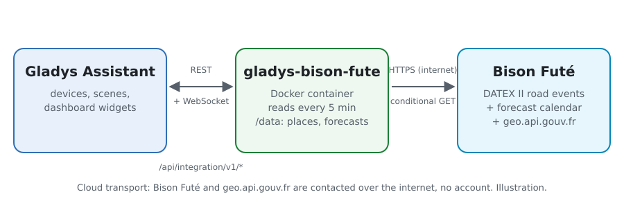
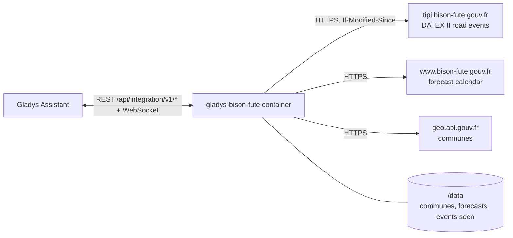
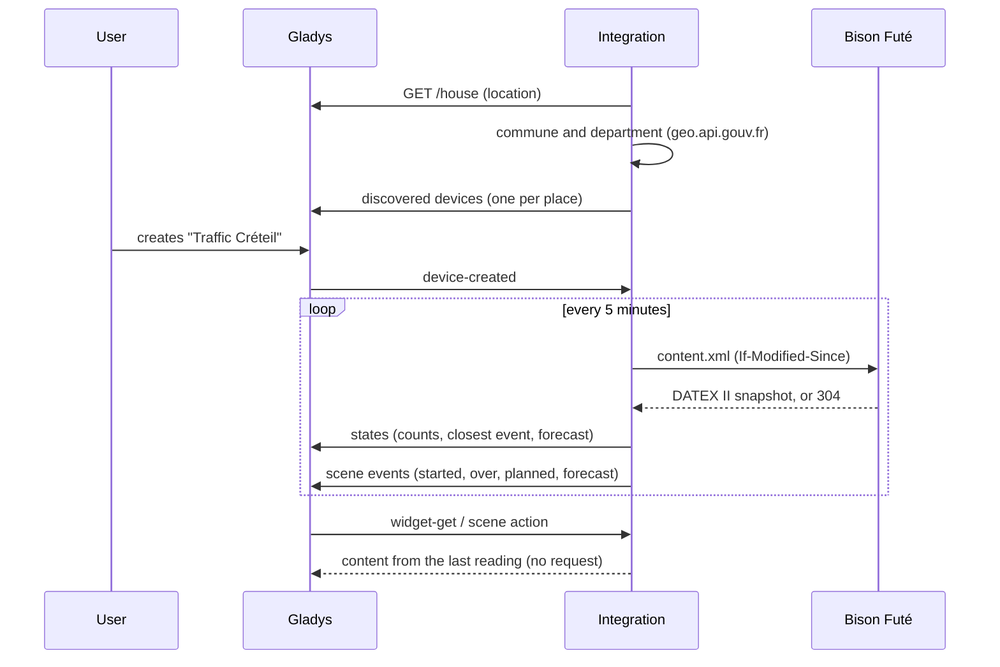
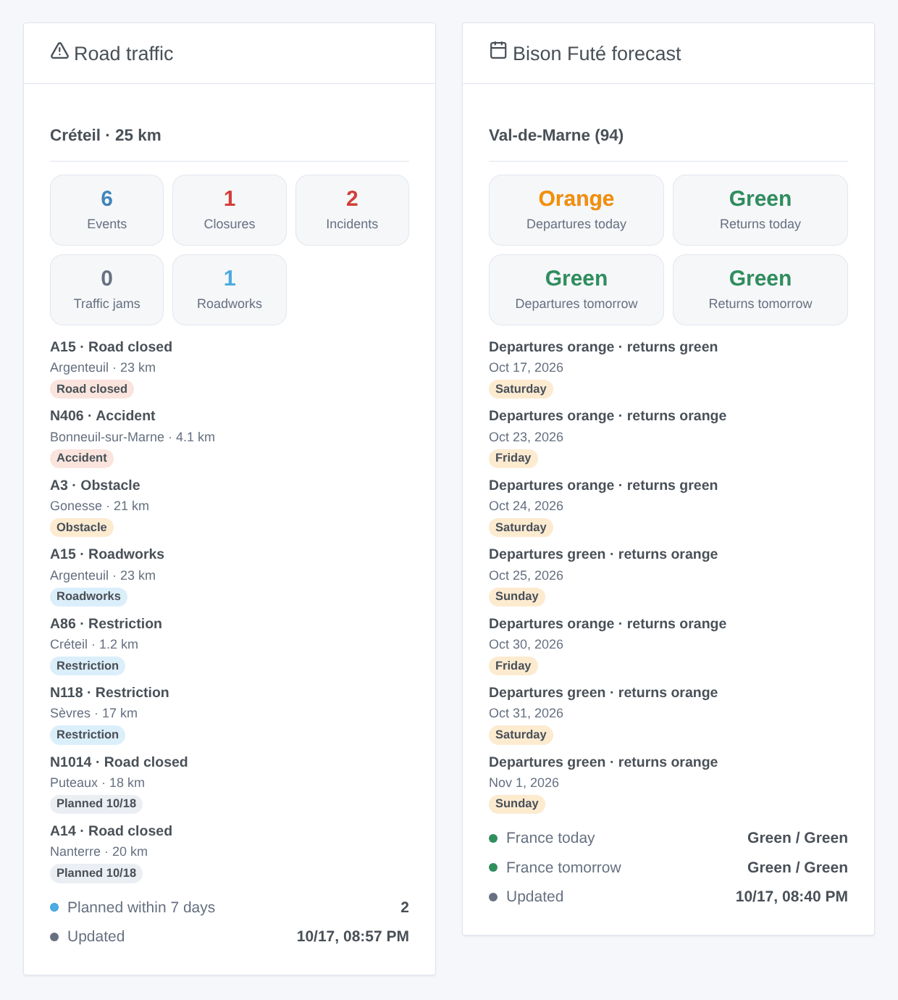

# Gladys Bison Futé

**English** · [Français](README.fr.md) · [Deutsch](README.de.md) · [Español](README.es.md)

[](LICENSE)
[](https://github.com/William-De71/gladys-bison-fute/releases)
[](https://github.com/William-De71/gladys-bison-fute/actions/workflows/release.yml)
[](https://gladysassistant.com)


[Gladys Assistant](https://gladysassistant.com) external integration for **Bison Futé**, the French road information service: the closures, accidents, traffic jams and roadworks around your home on the national roads, and the green, orange, red or black traffic forecast of your department. No account and no key: it reads the open data of the State road agencies.

User documentation: [English](docs/en.md) · [Français](docs/fr.md) · [Deutsch](docs/de.md) · [Español](docs/es.md).

> Community integration, not affiliated with nor endorsed by Bison Futé, the French Ministry in charge of transport or the road agencies (DIR).

## Features

- **One device per place** (a house of Gladys or a commune, up to three), with a **radius** (1 to 200 km) and, if you wish, **only the roads of your route** ("N79, A6").
- **Road events** of the zone: all of them, closures, accidents and obstacles, traffic jams, roadworks, and the closest one as text.
- **Bison Futé forecast** of the department: departures and returns, today and tomorrow (green, orange, red, black), for mainland France.
- **4 scene triggers**, **2 scene actions** and **2 dashboard widgets** (below).
- One small download every 5 minutes by default (about 150 KB, nothing when the feed did not change); the forecasts every six hours.
- Four languages everywhere: English, French, German, Spanish.

## How it works





The integration asks Gladys for the location of the chosen house, finds its commune and department on geo.api.gouv.fr, then reads the DATEX II snapshot of the national road network published by the road agencies (DIR) on Bison Futé: about 250 situations for the whole of France, each with its type, its road, its place and its dates. It keeps the ones within the radius of each place (and on its roads, if you listed some), sorts them (closures and accidents first, then the closest) and compares them with the previous reading to fire the scene triggers. The forecasts come from the calendar of the bison-fute.gouv.fr website.



### Transport

Cloud only (`"transports": ["cloud"]`): the catalog shows the cloud badge. The integration contacts `tipi.bison-fute.gouv.fr`, `www.bison-fute.gouv.fr` (public files, no account, nothing sent but a standard request) and `geo.api.gouv.fr` (only the coordinates of the chosen house or the commune you typed). Nothing else leaves your network; there is no local alternative, so there is no "prefer the local connection" button.

## Devices and features

| Feature                                                                 | Category / type              | Values                            |
| ----------------------------------------------------------------------- | ---------------------------- | --------------------------------- |
| Road events, closures, accidents and obstacles, traffic jams, roadworks | `counter-sensor` / `integer` | 0 … 999 active events of the zone |
| Closest road event                                                      | `text` / `text`              | "N79 · Accident · 3.2 km"         |
| Forecast departures, returns, today, tomorrow                           | `risk` / `integer`           | 0 green, 1 orange, 2 red, 3 black |

The forecast features exist only where Bison Futé publishes forecasts (mainland France without Corsica). Gladys shows the `risk` levels as no, low, medium and high risk; the widgets show the Bison Futé colors. An event is active between its start and its end; a planned event counts once it starts, a suspended one does not.

**What the feed covers**: the national roads and the motorways without toll, run by the State road agencies (DIR), Île-de-France included. The toll motorways (Vinci, APRR, Sanef…) and the departmental roads are not in this open feed: a jam on a toll motorway is not seen.

## Scene triggers, actions and widgets



**Scene triggers** (once per transition; the first reading of a place is a reference and fires nothing):

- **Road event started**: a road event becomes active in the zone (an accident, a closure that starts, a traffic jam). Filters: place, types, road.
- **Road event over**: an active event is over (the road reopens). Filters: place, types, road.
- **Road event planned**: a new event is announced for the next seven days (a night closure for roadworks). Filters: place, types, road.
- **Orange, red or black forecast**: for today from 6 am, for tomorrow from 6 pm the day before, again if it worsens. Filters: place, day, direction, levels.

**Scene actions**: **read the road events** of a place (counts, closest event, a ready-made list) and **read the forecast** of today or tomorrow (levels, France, the next orange or worse day, a summary).

**Widgets**: **Road traffic** (counts, the active then planned events, update time) and **Bison Futé forecast** (departures and returns today and tomorrow, the next coloured days, France).

Examples:

- When **a road event of type closure or accident starts on the N118** → send `{{triggerEvent.data.summary}}` to your phone before you leave.
- When **the forecast for tomorrow is red for departures** → remind the family the evening before to leave early.
- Every weekday at 7:30 → **read the road events** of the workplace and, if `count` is above 0, send the `summary` list.

## Requirements

- Gladys Assistant **5.2.0** or later (house selector in the configuration). Older instances cannot install the integration.
- A house of Gladys with its location, or the name of a French commune. No account, no key.

## Installation

- **From the store** of Gladys (Integrations → External integrations), in one click, once indexed.
- **From the repository URL**: `https://github.com/William-De71/gladys-bison-fute`.
- **Developer mode**: build the image locally (`docker build -t gladys-bison-fute .`) and install it from Gladys.

## Configuration

| Field                  | Description                                                                   |
| ---------------------- | ----------------------------------------------------------------------------- |
| House (1 to 3)         | A house of Gladys: its location is the centre of the zone.                    |
| Or a commune (1 to 3)  | "Mâcon", "71000", "Saint-Denis 93200" or the INSEE code; wins over the house. |
| Radius (km)            | 1 to 200 km, 20 by default.                                                   |
| Only these roads       | "N79, A6": only the events of these roads. Empty: every road of the zone.     |
| Road events read every | 2, 5 (default), 10, 15 or 30 minutes.                                         |
| Language of the texts  | Device names, closest event, scene summaries.                                 |

Buttons: **Read now** (at most once a minute) and **Diagnostic** (writes the places, the events of each zone and the last error to the Logs tab).

## Usage

1. Choose a house (or type a commune), set the radius and, if you wish, your roads, then save.
2. In the **Discover** tab, create the "Traffic …" device of each place.
3. Add the **Road traffic** and **Bison Futé forecast** widgets to a dashboard, and build scenes with the triggers above.

## Development

```bash
npm install
npm test                       # node --test, never touches the network
npm run lint && npm run format:check
npx github:GladysAssistant/integration-store . --skip-image-check
scripts/build-cover.sh         # cover.jpg from docs/assets/cover.svg
docs/illustrations/render.sh   # docs/assets/widgets.<lang>.png
node .github/scripts/release.mjs next
```

Locally, the SDK reads `GLADYS_HOST_API_URL`, `GLADYS_INTEGRATION_TOKEN` and `GLADYS_INTEGRATION_SELECTOR`; `DEBUG=gladys-integration-sdk` shows the SDK logs and checks every widget content. The tests use real files of Bison Futé, reduced (`test/fixtures/`). The rules of the project are in [CLAUDE.md](CLAUDE.md).

## Release process


Every merge on `main` runs the CI, then computes the version from the [Conventional Commits](https://www.conventionalcommits.org/) since the last tag: `feat` → minor, `fix` / `perf` → patch, `!` or `BREAKING CHANGE` → major (a minor below 1.0.0); `docs`, `chore`, `ci`, `test`, `style`, `refactor`, `build` alone publish nothing. The changelog section is generated, the tag pushed, the multi-architecture image built, then `main` receives the release commit, the GitHub Release is created and a last job checks the public image, the store validator and the topic.

- The pull request title becomes the squash commit, then the changelog line: write it in English, for the user (`pr-title.yml` checks it). Never edit `CHANGELOG.md` by hand.
- 1.0.0 is a decision: Actions → Release → Run workflow with `release-as: 1.0.0`. `dry-run` shows the version and the notes without publishing.
- **Protected branch**: the release pushes its commit to `main` with `GITHUB_TOKEN`. With a ruleset on `main`, add GitHub Actions to its bypass list (or push through a GitHub App), otherwise the publish job fails with instructions.
- After the first release, make the `ghcr.io` package public (Package settings → Change visibility), or Gladys cannot pull it.

## Troubleshooting

See [docs/en.md](docs/en.md#troubleshooting). Report issues with the versions of Gladys and of the integration, the place, and the lines of the **Diagnostic** button.

## Contributing

Issues and pull requests are welcome. Run `npm run format:check && npm run lint && npm test` before opening a pull request, and keep every external id and stored key unchanged (see [CLAUDE.md](CLAUDE.md)).

## Security

See [SECURITY.md](SECURITY.md): report vulnerabilities privately. The integration has no secret to keep: it reads public files, sends nothing but the location of the chosen house to geo.api.gouv.fr, and runs read-only, as a non-root user, in its container.

## Screenshots to come

The images above are illustrations, not screenshots. Real screenshots will go in `docs/assets/screenshots/` (PNG, 1280 × 800): `configuration.png`, `discovery.png`, `device.png`, `scene.png`.

## License

[Apache License 2.0](LICENSE) — see also [NOTICE](NOTICE). The road events are open data of the State road agencies (DIR), published by Bison Futé under the Licence Ouverte 2.0 (Etalab): the widgets show the source of each event and the update time. Thanks to the Gladys documentation and SDK, and to the Bison Futé and transport.data.gouv.fr teams for opening these data.
